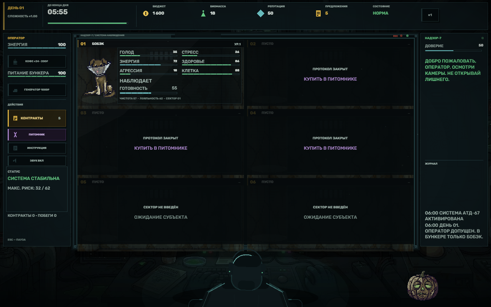
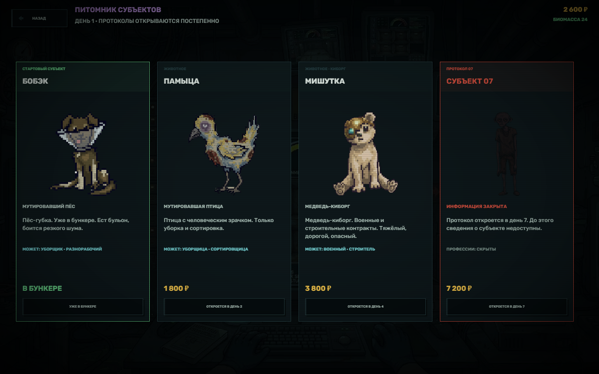
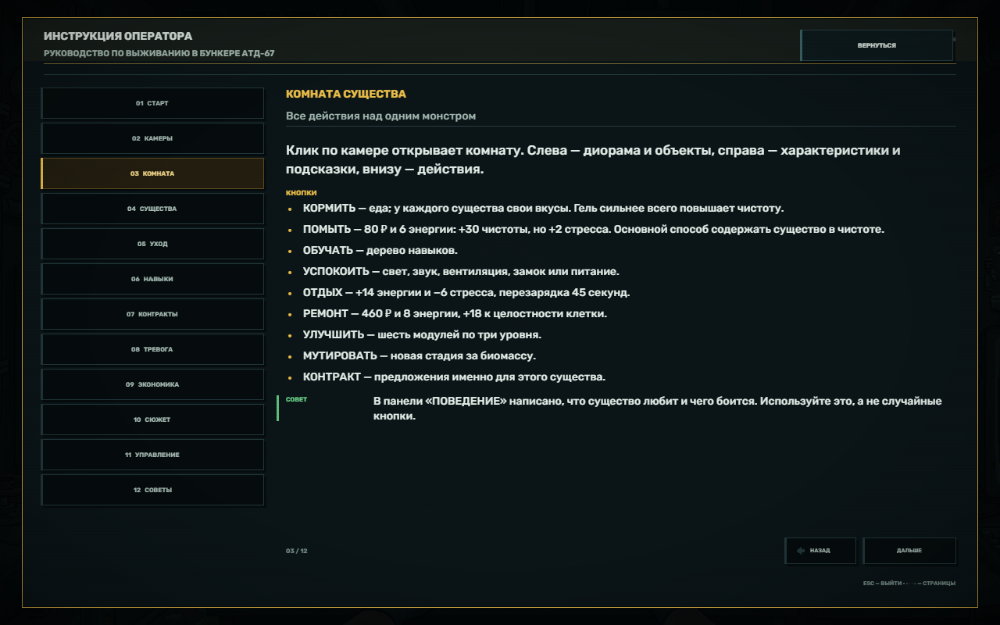

# БУНКЕР АТД-67

2D pixel-art horror simulator / creature management на Phaser 3.

Вы — оператор подземного бункера «АТД-67». Сначала у вас только один подопытный — Бобэк.
Кормите его, успокаивайте, обучайте, покупайте новых существ и отправляйте их на контракты.
С каждым днём бункер становится опаснее, а НАДЗОР-7 — разговорчивее.







## Возможности

- Офис оператора с шестью камерами, CRT-эффектами, статусами существ и анимированным силуэтом оператора.
- Старт с одним Бобэком. Остальные существа покупаются в питомнике: Памыца со 2-го дня, Мишутка с 4-го, Водолазик с 7-го.
- Четыре уникальных существа с разными профессиями: Бобэк — уборка/разнорабочий, Памыца — только уборка, Мишутка — военные/строительство, Водолазик — универсал.
- Восемь характеристик: голод, стресс, энергия, здоровье, агрессия, чистота, целостность клетки, лояльность.
- Кормление с предпочтениями, обучение по трём веткам навыков, успокоение инструментами, отдых, ремонт, шесть модулей клетки.
- Кликер мутаций: шкала в комнате показывает, сколько нажатий осталось до следующей стадии; финальное превращение стоит биомассу.
- Три стадии мутаций у каждого существа (спрайты стадий из предоставленных материалов).
- Рынок компаний с пятью предложениями за день, требованиями к готовности, профессиями, оплатой, риском и потерей связи.
- Тревоги, побеги, средства сдерживания, рост адаптации после побегов, аварийный протокол.
- Экономика: старт 1600 ₽, дорогие еда/обучение/улучшения; генератор стоит 1000 ₽; бюджет, биомасса, репутация, энергия оператора, питание бункера.
- Случайные события и НАДЗОР-7: подсказки, частая ложь, отключение камер, сюжетные записки и цензурированный журнал.
- Помехи на камере блокируют взаимодействие с существом, пока вы не восстановите связь.
- Устранение помех — мини-игра: кликер на 5–10 нажатий или код из 4–6 цифр.
- Лимит одновременных контрактов: N−1 от числа купленных существ (минимум 1).
- Уход: кормление, обучение, сон, сдерживание и мытьё. «ПОМЫТЬ» стоит 80 ₽ и 6 энергии, даёт +30 чистоты, но немного повышает стресс; гель в кормлении тоже очищает.
- Периодическое обслуживание бункера: ремонт электросети (до 7 проводов) или сортировка образцов (до 6). Игровое время не останавливается. Чем меньше свободных существ, тем сложнее задание. Интервал: единственное существо на контракте — 10–20 секунд; ровно половина — 1 минута; больше половины — 15–30 секунд; иначе — 1,5–2 минуты, при нормальных показателях чаще.
- Новая история из девяти записок и договора с пунктом 4.3, финальная развилка и шесть концовок, включая «стать субъектом 00».
- Встроенное руководство из 12 разделов: быстрый старт, камеры, комната, существа, уход, навыки, контракты, тревоги, экономика, сюжет, управление и частые ошибки.
- Рост сложности по дням: быстрее падают характеристики, чаще события, тревоги и подлянки ИИ. Голод, чистота, энергия, агрессия и целостность клетки ускорены, а стресс оставлен на прежней скорости.
- Автосохранение в LocalStorage, проверка целостности и восстановление после повреждённого файла.
- Музыка и звуки из папки `sounds/`: меню, эмбиент, концовка, скримеры, сирена, голоса существ и редкие жуткие звуки. WAV-эмбиент сжат в `sounds/processed/` для автономной сборки.
- В комнатах случайно появляются декоративные тыквы из `assets/pumpkins/` — на безопасных местах у стен, не перекрывая интерфейс и существо.
- Автономная сборка `bunker-atd-67.html`: открывается двойным щелчком, без сервера и без внешних запросов.
- Полностью локальная версия: без SDK, облачных сервисов и внешних сетевых запросов.

## Запуск

**Просто откройте `bunker-atd-67.html` двойным щелчком.** Сервер не нужен: это автономный HTML,
внутри которого лежат Phaser, все модули, картинки и шрифты.

Можно открывать и `index.html` — при запуске с диска он сам перенаправит на `bunker-atd-67.html`.

> ES-модули и загрузка файлов по `file://` блокируются браузером, поэтому автономная сборка
> собирается в один HTML. Исходники в `src/` остаются модульными для разработки.

### Разработка

Для правки исходников удобнее локальный сервер: `index.html` в этом режиме запускает модульную версию.

```bash
python -m http.server 8080
# открыть http://127.0.0.1:8080
```

После изменений в `src/`, `style.css` или `assets/` пересоберите автономный файл:

```bash
pnpm install              # один раз, нужен esbuild
node scripts/build-standalone.mjs
# или: pnpm run build:standalone
```

Сборка занимает несколько секунд и перезаписывает `bunker-atd-67.html`.

### Отладочные экраны

Параметры URL (удобно для проверки и скриншотов):

- `?screen=office`, `?screen=room`, `?screen=market`, `?screen=shop`, `?screen=report`, `?screen=ending`, `?screen=intro`, `?screen=horror`
- `?fresh=1` — очистить сохранение перед запуском
- `?seed=12345` — фиксированный сид

## Управление

| Действие | Управление |
|---|---|
| Открыть комнату | клик/тап по камере |
| Вернуться в офис | кнопка «НАЗАД» или ESC в комнате |
| Контракты | кнопка «КОНТРАКТЫ» (в комнате — «КОНТРАКТ») |
| Питомник | кнопка «ПИТОМНИК» в офисе или на рынке |
| Пауза | ESC в офисе |
| Звук | M или кнопка «ЗВУК» |
| Аварийная камера | SPACE |
| Скорость дня | кнопка ×1 / ×2 в верхней панели |

## Как играть

1. Смотрите на камеры: красная рамка и метка «ТРЕВОГА» означают, что существо готово к побегу.
2. Откройте комнату и используйте инструмент, подходящий его триггерам (подсказка в панели поведения).
3. Кормите любимой едой, обучайте навыкам, улучшайте клетку и поддерживайте готовность к контракту.
4. Покупайте новых существ в питомнике под нужные профессии.
5. Принимайте контракты на рынке: существо уходит из бункера на время дня. Результат зависит от готовности, профессии, навыков, мутаций и риска.
6. Наполняйте шкалу мутации кликером в комнате, затем платите биомассу за новую стадию.
7. Кнопки досрочного завершения дня нет: дождитесь конца дня. После отчёта начинается следующий.
8. При побеге или нуле энергии день **не засчитывается** и начинается заново; прогресс дня сбрасывается к его началу.
9. К десятому дню доступны финальные решения. Одна из концовок — стать субъектом 00.

День длится 6 минут. Характеристики существ падают быстрее с каждым днём, события и тревоги случаются чаще.
Энергия оператора ограничивает действия; кофе стоит 200 ₽ и восстанавливает 24 единицы. Генератор стоит 1000 ₽.

## Архитектура

```
index.html / style.css      оболочка, загрузочный экран, CRT-оверлеи, ошибки
bunker-atd-67.html          автономная сборка «всё в одном файле» (открывается без сервера)
scripts/build-standalone.mjs  упаковка модулей, картинок, звуков и шрифтов в один HTML
vendor/phaser.min.js        Phaser 3.80.1 (локально)
sounds/                     музыка, эмбиент, сирена, скримеры и голоса
src/audio/tracks.js         списки аудиофайлов
src/main.js                 загрузка шрифтов, конфиг Phaser, аудио
src/config/balance.js       весь баланс, тайминги, пороги, цены
src/data/                   существа, еда, улучшения, компании, инструменты, сюжет
src/systems/                чистая логика: существа, контракты, угрозы, события, ИИ, сюжет, отчёты, обслуживание
src/managers/               GameManager, SaveManager, AudioManager
src/scenes/                 Boot, Menu, Intro, Office, Room, Market, Shop, Report, Horror, Ending, Modal, Guide, Maintenance
src/entities/               CameraWindow, Operator
src/ui/                     тема, иконки, кнопки, бары, журнал, фоны
src/utils/                  эмиттер, RNG, форматирование
tests/                      логические тесты, CDP-скриншоты и UI-тесты
```

`GameManager` — единственная точка входа для действий игрока и тика симуляции. Сцены не хранят игровое состояние:
они читают `manager.state` и подписываются на события шины (`tick`, `log`, `alarm`, `escape`, `shift-end` и т. д.).
Системы не импортируют Phaser и покрыты Node-тестами.

### Сохранение

- Ключ: `atd67_save_v1` в LocalStorage, версия структуры — `4`.
- Автосохранение каждые 15 секунд, при завершении дня, перед выгрузкой страницы и на важных действиях.
- При повреждении JSON создаётся резервная копия `atd67_save_v1_broken`, игра предлагает начать заново.
- Сохраняются день, снимок начала дня, ресурсы, существа, навыки, мутации, улучшения, контракты, журнал, сюжет, концовки и статистика.

### Баланс

Все числа — в `src/config/balance.js` и `src/data/*.js`. Ставки указаны за минуту дня.
Чтобы изменить длительность дня, поменяйте `shift.durationSec` (по концепции — не больше 600 секунд).

## Тесты

```bash
node tests/run-tests.mjs        # 28 логических тестов (день, побег, магазин, кликер, обслуживание, сохранения и т. д.)
node tests/interaction.mjs      # реальные клики в headless Edge через CDP (23 шага)
node tests/screenshot.mjs <url> <out.png> [waitMs] [expr] [width] [height]
```

UI-тесты требуют запущенный сервер на `http://127.0.0.1:8123` и установленный Microsoft Edge.
Для скриншотов можно задать размеры через переменные окружения `ATD_W` и `ATD_H`.

## Материалы

- Исходные изображения из папки `assets/` сохранены без изменений. Тыквы — `assets/pumpkins/pump1–3.png`.
- Производные спрайты (обрезанные стадии и миниатюры) лежат в `assets/creatures/`; фоны — `office_bg.png`, `room_bg.png`, `cam_bg.png`.
- Шрифт: Rubik (SIL Open Font License), лицензия — в `assets/fonts/OFL-Rubik.txt`.
- Phaser 3.80.1 распространяется по лицензии MIT.
- Звук: файлы из `sounds/`, плюс процедурные WebAudio-эффекты интерфейса. Музыка меню, эмбиент, концовка, сирена, скримеры и голоса управляются через `AudioManager`.

## Ограничения первой версии

- Мобильные устройства поддерживаются в горизонтальной ориентации; интерфейс плотный и на узких экранах читается мелко.
- Контент рассчитан на 10 дней; после финала доступны архив концовок и новая партия.
- Секторы 5 и 6 намеренно оставлены пустыми под будущих существ.
